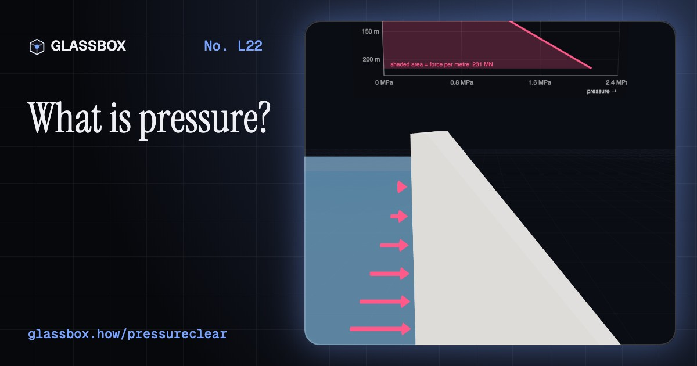
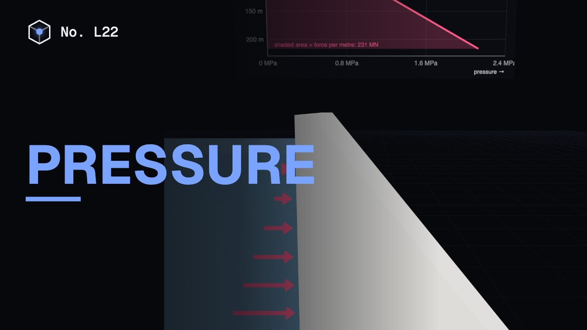
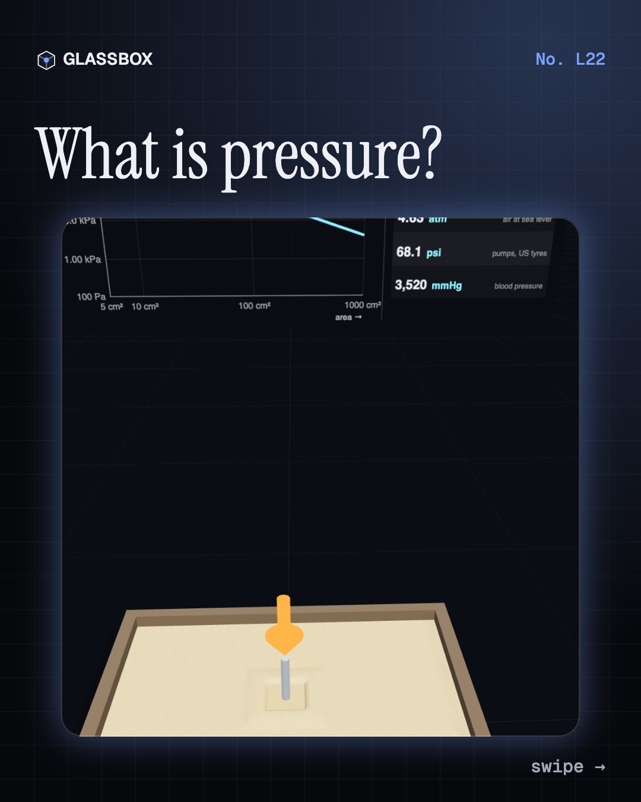
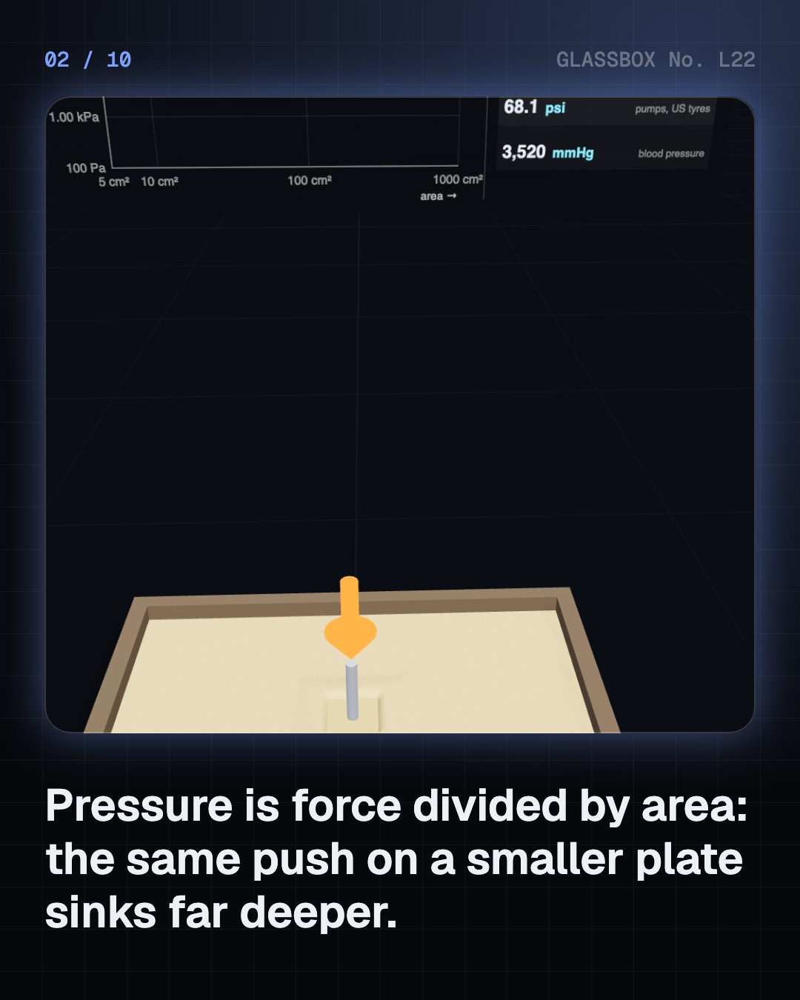
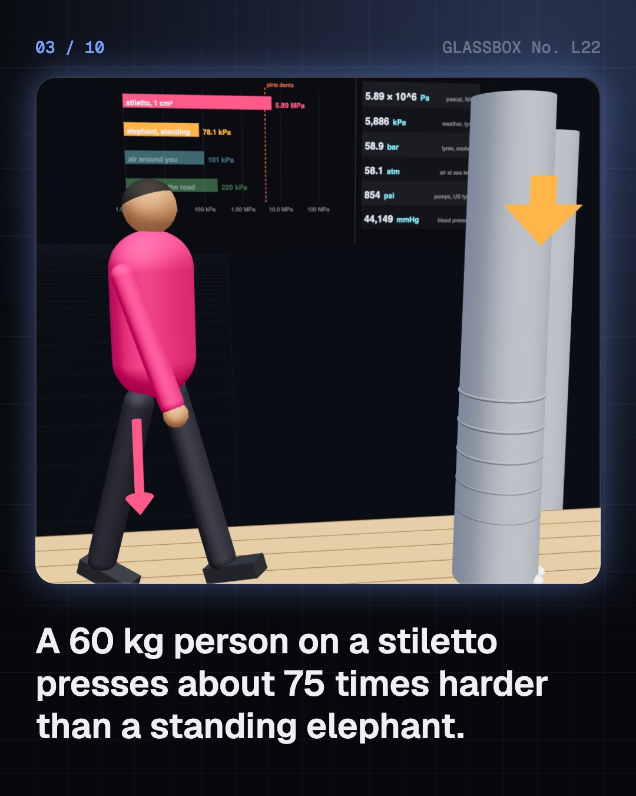
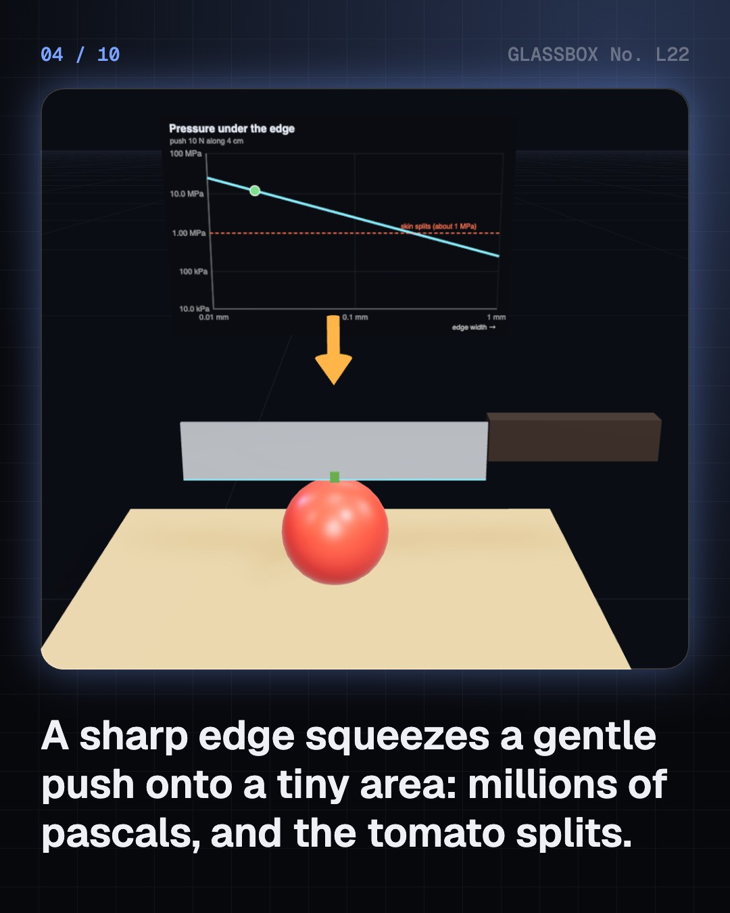

<!-- glassbox:start -->
<!-- Generated from glassbox.json by the Glassbox hub (npm run readme -- pressureclear). Edit glassbox.json, not this block. -->
<p align="center"><a href="https://glassbox.how/e/pressureclear/"></a></p>

<h1 align="center">Pressure</h1>

<p align="center"><b>What is pressure?</b><br>Why does a stiletto dent a floor an elephant wouldn’t, why is a dam thickest at the bottom, and why does dal cook faster under a whistle? Squash sand, cut a tomato, lie on nails, fill a dam, pump out Magdeburg’s hemispheres and dive the Mariana Trench.</p>

<p align="center"><a href="https://glassbox.how/pressureclear/"><b>▶ Play with it</b></a> &nbsp;·&nbsp; <a href="https://glassbox.how/e/pressureclear/">Read the 60-second explainer</a> &nbsp;·&nbsp; <a href="https://glassbox.how/pressureclear/glassbox/reel.mp4">Watch the 40-second video</a></p>

<p align="center">
  <a href="https://glassbox.how/e/pressureclear/"></a>
  <a href="https://glassbox.how/e/pressureclear/"></a>
  <a href="LICENSE"></a>
  <a href="LICENSE-CONTENT.md"></a>
  <a href="#privacy"></a>
</p>

## In 60 seconds

1. **Force on an area.** Pressure is force divided by area, P = F ÷ A, measured in pascals: one newton on one square metre. Press a plate into sand and halve its area: the pressure doubles and it sinks deeper. A brick on its end presses three times harder than lying flat, and a stiletto heel beats an elephant by about 75 times. The units board shows every pressure in Pa, kPa, bar, atm, psi and mmHg.
2. **Sharp and wide.** A sharp knife’s edge turns 10 N into megapascals and splits a tomato; a blunt one squashes it. Snowshoes, a bed of a thousand nails and fat low-pressure tractor tyres spread weight to keep pressure low. A tyre’s contact patch is about load ÷ pressure: palm-sized for a car at 2.2 bar, stamp-sized for a bike at 6 bar.
3. **Deeper means harder.** Under a liquid, P = ρ g h: every 10 m of water adds about 1 bar. A rooftop tank gives the ground floor about 1 bar, far short of an RO pump’s 5. Bhakra Dam’s 226 m of water press at 2.2 MPa at the base. Unequalised ears hurt a metre or two down, and blood pressure is highest at your ankles.
4. **An ocean of air.** Air presses at about 101 kPa at sea level. Pump air out of Magdeburg hemispheres and 20 kN clamps them. A straw lifts juice by lowering the pressure in your mouth. Pressure falls with height, to 65 kPa in Leh and a third on Everest, so water boils cooler; a pressure cooker’s 82 g whistle holds 1 bar extra and boils at 120 °C. A mercury barometer stands 760 mm tall.
5. **Myths and extremes.** Gauges show pressure above the air: a “flat” tyre still holds 1 atm. Suction never pulls, the outside air pushes, so a suction cup fails on Mars. The Mariana Trench presses at about 1,086 bar. And vessels of any shape filled to the same depth have the same pressure at the bottom: Stevin’s hydrostatic paradox.

## Words worth knowing

| Term | Meaning |
|---|---|
| **Pressure** | Force divided by the area it acts on, P = F ÷ A. |
| **Pascal (Pa)** | The SI unit of pressure: one newton per square metre. 1 bar = 100,000 Pa; 1 atm = 101,325 Pa. |
| **Hydrostatic pressure** | Pressure in a still liquid from the weight above: P = ρ g h. About 1 bar per 10 m of water. |
| **Atmospheric pressure** | The weight of the air above pressing on everything, about 101 kPa at sea level and less as you climb. |
| **Gauge and absolute pressure** | Gauges read the pressure above the surrounding air; absolute pressure adds the air’s 1 atm back. |
| **Barometer** | An instrument that measures air pressure, first a column of mercury about 760 mm tall (Torricelli, 1643). |
| **Boiling point** | The temperature where water’s vapour pressure matches the pressure around it: lower up mountains, higher in a pressure cooker. |
| **Hydrostatic paradox** | Pressure at the bottom of a liquid depends only on depth, not on the shape or size of the container. |

## A short history

**From a pump that would not lift water past ten metres to a steel ball on the floor of the deepest sea: 400 years of learning that air and water push.**

- **1586** · Stevin's hydrostatic paradox (Simon Stevin, Leiden, Netherlands)
- **1643** · Torricelli's mercury barometer (Evangelista Torricelli and Vincenzo Viviani, Florence, Italy)
- **1648** · A barometer climbs the Puy de Dôme (Florin Périer, for Blaise Pascal, Clermont-Ferrand, France)
- **1654** · Horses against the Magdeburg hemispheres (Otto von Guericke, Regensburg and Magdeburg, Germany)
- **1662** · Boyle's law: squeeze a gas, its pressure rises (Robert Boyle, Oxford, England)
- **1896** · Riva-Rocci's blood pressure cuff (Scipione Riva-Rocci, Turin, Italy)
- **1959** · Hawkins pressure cookers made in India (H. D. Vasudeva, Pressure Cookers and Appliances Ltd, Mumbai, India)
- **1960** · Trieste reaches the Challenger Deep (Jacques Piccard and Don Walsh, Mariana Trench, Pacific Ocean)

The full story, with 20 moments, charts, people and 36 sources: [glassbox.how/e/pressureclear/history](https://glassbox.how/e/pressureclear/history/). The data lives in [`history.json`](history.json).

## Video and slides

Made with the Glassbox studio from this box's storyboard (`window.glassbox.director`). Free to reuse under CC BY 4.0.

<a href="https://glassbox.how/pressureclear/glassbox/video.mp4"></a>

<p><a href="glassbox/slide-1.jpg"></a> <a href="glassbox/slide-2.jpg"></a> <a href="glassbox/slide-3.jpg"></a> <a href="glassbox/slide-4.jpg"></a></p>

| File | What | Size |
|---|---|---|
| [`glassbox/reel.mp4`](https://glassbox.how/pressureclear/glassbox/reel.mp4) | Reel / Short, with captions and soundtrack | 1080×1920 |
| [`glassbox/video.mp4`](https://glassbox.how/pressureclear/glassbox/video.mp4) | YouTube video, with captions and soundtrack | 1920×1080 |
| `glassbox/slide-1…10.jpg` | Instagram carousel | 1080×1350 |
| `glassbox/thumb.jpg` | YouTube thumbnail | 1280×720 |
| `glassbox/cover.jpg` | Share card and repo social preview | 1200×630 |
| [`glassbox/history-reel.mp4`](https://glassbox.how/pressureclear/glassbox/history-reel.mp4) | “History in 10 moments” Reel / Short | 1080×1920 |
| `glassbox/history-slide-*.jpg` | History carousel | 1080×1350 |
| `glassbox/post.json` | Post copy and schedule used by the publish kit | |

## Privacy

This box has no accounts and no ads, and it ships its own fonts and libraries. When you run it yourself it sends nothing anywhere. On glassbox.how, the site's `/bar.js` also loads Glassbox's analytics: **Google Analytics** to count visits (it asks first in the EU, UK and Switzerland, and stays off when your browser sends Global Privacy Control or Do Not Track) and **ClickTrust** to detect bots.

It remembers a few things **in your own browser only**, and never sends them anywhere:

| Browser storage key | What it holds |
|---|---|
| `pressureclear.v1` | Which chapters you have opened, your best quiz scores, and sound on or off. |

Exactly what each one sees is at [glassbox.how/privacy](https://glassbox.how/privacy/).

## Licences

- **Code:** [MIT](LICENSE). Use it, change it, ship it.
- **Explanations, text, images and videos** (`glassbox.json`, `glassbox/`): [CC BY 4.0](LICENSE-CONTENT.md). Credit “Glassbox, glassbox.how/e/pressureclear”.
- **Third-party parts** keep their own licences: [three.js](https://threejs.org) (MIT), [Geist, Instrument Serif](https://openfontlicense.org) (SIL OFL 1.1).
- The Glassbox name and logo aren't covered by either licence. See the [terms](https://glassbox.how/terms/).

Found a mistake? [Open an issue](https://github.com/bdeeps/pressureclear/issues). Corrections happen in public.
<!-- glassbox:end -->

## Run it

It's plain HTML, CSS and JavaScript. No build step and no dependencies. Run locally, it contacts no other website.

```bash
python3 -m http.server 8000
```

Three.js and the fonts ship in `vendor/` and `fonts/`, so it also works offline.

Then open http://localhost:8000.

## How it's built

| File | What |
|---|---|
| `index.html`, `css/app.css` | The page and its styles |
| `js/app.js`, `js/stage.js`, `js/ui.js`, `js/kit.js` | The shared Glassbox 3D engine: chapters, 3D stage, controls, quiz, video director |
| `js/chapters/*.js` | One file per chapter: the 3D model, controls, text, key terms, quiz and video scenes |
| `js/pressure.js` | Shared physics and parts: unit conversions, ρgh, the standard atmosphere, water's boiling point, chart boards, soft sand/snow beds, gas molecules, a person |
| `glassbox.json` | Title, question, explainer beats, key terms, browser storage and credits shown on glassbox.how |
| `reel` in each chapter | The storyboard the Glassbox studio records into short videos |
| `glassbox/` | The published video, slides, thumbnail and post copy |
| `fonts/`, `vendor/three/` | Self-hosted Geist and Instrument Serif (SIL OFL 1.1) and three.js (MIT) |
